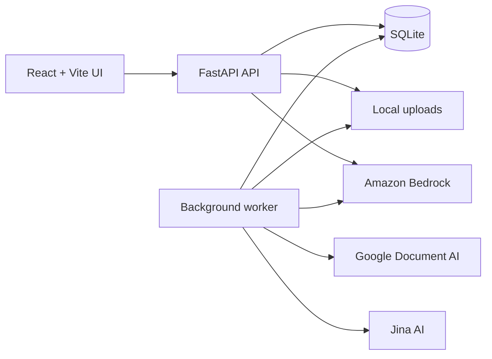
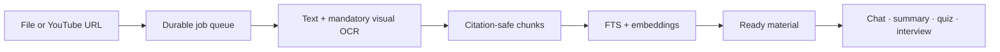

# LearnFlow AI

LearnFlow AI turns study files and captioned YouTube videos into a private, searchable learning workspace. It extracts text and visuals, creates citation-safe chunks and embeddings, and uses the selected sources for grounded chat, summaries, quizzes, and mock interviews.

The application is designed for a small prototype deployment: the React frontend can be hosted on Cloudflare Pages while the FastAPI API, worker, SQLite database, and uploaded files remain on one persistent computer.

## What it includes

- PDF, PPTX, PNG, JPG, and JPEG drag-and-drop ingestion
- Captioned YouTube transcript ingestion with thumbnails and timestamps
- Google Document AI OCR and Bedrock visual interpretation
- Jina embeddings with local lexical/dense retrieval
- Grounded Markdown chat, summaries, citations, and saved conversations
- Single-answer, multiple-answer, short-answer, and mixed quizzes
- Source-grounded mock interviews with reports and feedback
- User accounts, per-user data ownership, export, cleanup, and an admin usage view
- Nine named visual themes, each with accessible light and dark modes; Olive Library is the default
- Responsive page-based workspaces for materials, chat, summaries, quizzes, interviews, and history

## Architecture





Only Amazon Bedrock is used from AWS. OCR goes directly to Google Document AI without Google Cloud Storage. Metadata, extracted units, chunks, vectors, histories, quizzes, interviews, jobs, and usage counters are stored in SQLite. Original uploaded files remain on the local filesystem.

## Requirements

- Git
- Node.js 20 or newer
- Python 3.10 or newer
- API credentials for the cloud features you enable

## First-time setup on Windows

```powershell
git clone https://github.com/ZigzagDeck/LearnflowAI.git
cd LearnflowAI
git checkout vm

npm install
python -m venv .venv
.\.venv\Scripts\python.exe -m pip install -r backend\requirements.txt
Copy-Item .env.example .env
```

Edit `.env` and add your real credentials. Never commit `.env`, service-account JSON, database files, or uploaded material.

The main settings are:

| Purpose | Required settings |
| --- | --- |
| Administrator | `LEARNFLOW_ADMIN_EMAIL`, `LEARNFLOW_ADMIN_PASSWORD` |
| Google OCR | `GOOGLE_CLOUD_PROJECT`, `GOOGLE_DOCUMENT_AI_LOCATION`, `GOOGLE_DOCUMENT_AI_PROCESSOR_ID`, plus `GOOGLE_APPLICATION_CREDENTIALS` or `LEARNFLOW_GOOGLE_SERVICE_ACCOUNT_JSON` |
| Jina embeddings | `JINA_API_KEY` |
| Bedrock generation | `LEARNFLOW_BEDROCK_CHAT_ENABLED=true`, `AWS_REGION`, `AWS_BEARER_TOKEN_BEDROCK`, `LEARNFLOW_BEDROCK_MODEL_ID` |
| Hosted frontend | `VITE_API_BASE_URL`, and the same origin in `LEARNFLOW_CORS_ORIGINS` |

There are no hard-coded or default administrator credentials. An administrator account is created or updated when both `LEARNFLOW_ADMIN_EMAIL` and `LEARNFLOW_ADMIN_PASSWORD` are set in `.env` and the API is restarted. The admin link is only visible after signing in with that configured account.

The checked-in [.env.example](.env.example) documents every supported option and contains placeholders only. Local OCR and local embedding fallback are disabled by default so testing cannot unexpectedly consume laptop memory.

## Start the application

Open three PowerShell windows in the project folder.

API:

```powershell
.\.venv\Scripts\python.exe -m uvicorn backend.main:app --reload --port 8000
```

Worker:

```powershell
.\.venv\Scripts\python.exe -m backend.worker
```

Frontend:

```powershell
npm run dev
```

Open [http://localhost:5173](http://localhost:5173). The API health check is [http://localhost:8000/health](http://localhost:8000/health).

Keep the worker running whenever materials are being processed. Uploading queues the work; the API does not perform OCR or embedding inside the web request.

## Normal use

1. Register or sign in.
2. Drop a supported file or paste a public YouTube URL.
3. Wait until the material becomes **Ready**.
4. Move between the dedicated **Materials**, **Ask AI**, **Summary**, **Quiz**, **Interview**, and **History** pages from the workspace header.
5. Select one or more materials in chat, summary, quiz, or interview.
6. Open citation chips to inspect the supporting page, slide, image, or video timestamp.
7. Use **History** to view extracted content or delete an incorrect ingestion.

Use the theme picker beside the profile to choose **Olive Library**, **Midnight Terminal**, **Daylight Desk**, **Botanical Notes**, **Blueprint Studio**, **Legal Archive**, **Classic Academy**, **Creative Atelier**, or **Neon Quest**. The adjacent sun/moon control switches the selected theme between light and dark mode. Both choices are saved in the browser.

YouTube ingestion uses existing manual or automatic captions; it does not download video or audio. Private, restricted, captionless, or host-blocked videos cannot currently be transcribed.

## Storage and limits

Default local paths:

- Database: `backend/data/learnflow.db`
- Uploaded files: `backend/uploads/`
- Optional local model cache: `backend/data/models/`

All are ignored by Git. Back up both the database and uploads directory together. The UI data export contains portable account records and extracted content, but not original file bytes.

Protect paid services with both the app's local monthly limits and provider-side budgets. Deleting the local database also deletes the app's usage counters. This prototype runs one extraction job at a time to control CPU and memory usage.

## Verification

```powershell
npm run lint
npm run build
.\.venv\Scripts\python.exe -m compileall -q backend
.\.venv\Scripts\python.exe -m pytest backend\tests -q
```

## Cloudflare Pages frontend

The browser must reach the API over a stable HTTPS address; `localhost` in a deployed frontend points to the visitor's computer, not yours.

1. Push the `vm` branch to GitHub.
2. In Cloudflare Pages, import `ZigzagDeck/LearnflowAI` and select `vm`.
3. Use build command `npm run build` and output directory `dist`.
4. Add `VITE_API_BASE_URL=https://api.your-domain.example` in the Pages build settings.
5. Expose the laptop API through a named Cloudflare Tunnel mapped to `http://localhost:8000`.
6. Set `LEARNFLOW_CORS_ORIGINS` in `.env` to the exact Pages URL, then restart the API.
7. Keep the laptop, API, worker, tunnel, database, and uploads online during demonstrations.

Do not expose port 8000 directly on the router. Authentication, application rate limits, and per-user ownership are included, but public production use still needs managed backups, email verification/password recovery, stronger edge controls, monitoring, and secret rotation.

## Project map

- `src/` — React interface and theme
- `backend/main.py` — FastAPI application and material endpoints
- `backend/worker.py` — durable ingestion worker
- `backend/resource_store.py` — SQLite schema and persistence
- `backend/extraction.py`, `ocr.py`, `visual_understanding.py` — document processing
- `backend/embeddings.py`, `retrieval.py`, `chunking.py` — indexing and retrieval
- `backend/*_service.py` — chat, summary, quiz, and interview behavior
- `backend/tests/` — backend test suite
- `REPORT.md` — detailed engineering history and decisions

## Current scope

This repository is suitable for private use and small prototype demonstrations on a single persistent backend. Captionless video/audio transcription, multi-instance database coordination, object storage, password recovery, and generating answers in the chat section based on internet are intentionally outside the current implementation.
