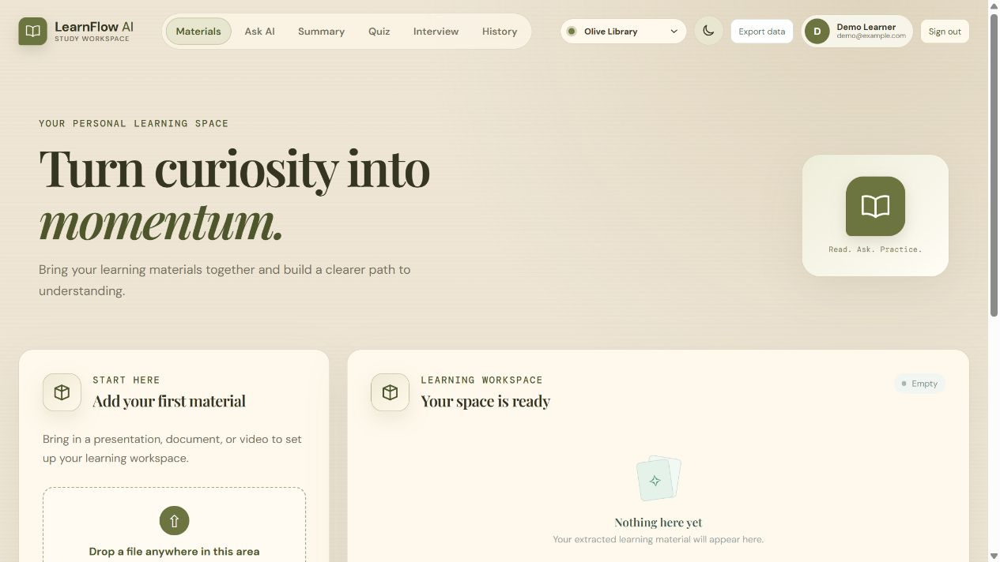
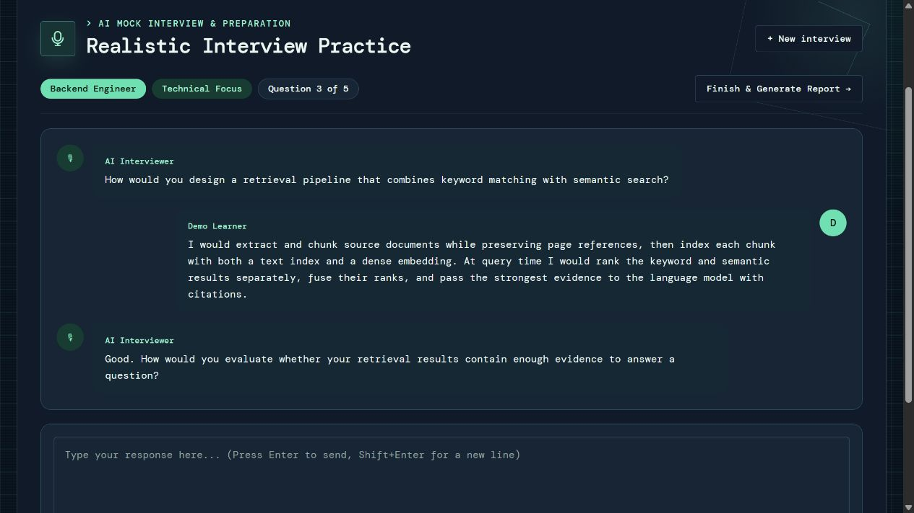
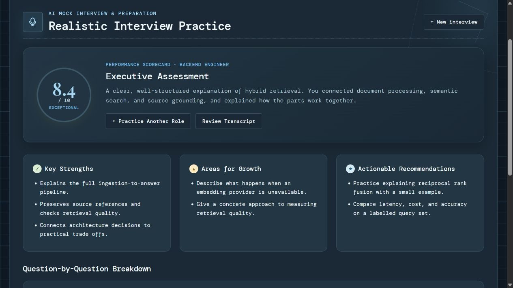
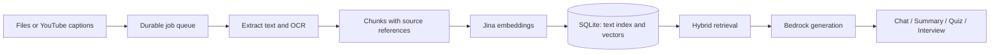

<div align="center">


# LearnFlow AI

### Turn “I’ve read it” into “I can explain it.”

One thoughtful workspace for your sources, questions, and next breakthrough.

**Read with context. Ask with evidence. Practice with purpose.**

[](https://tinyurl.com/Learn-Flow-AI)
[](https://github.com/ZigzagDeck/LearnflowAI/actions/workflows/ci.yml)


[Live demo ↗](https://tinyurl.com/Learn-Flow-AI) · [Experience](#a-workspace-that-moves-with-your-learning) · [Screenshots](#a-closer-look) · [Architecture](#from-upload-to-understanding) · [Run locally](#run-locally) · [Deployment](#deployment)

</div>

<br />



<p align="center"><em>A calm place to bring your learning materials together. Olive Library · light mode.</em></p>

> **Try the live demo:** [Open LearnFlow AI](https://tinyurl.com/Learn-Flow-AI), create an account, upload a small PDF, and wait for **Ready**. Select your source, ask a question, then turn what you learned into a quiz or mock interview.

---

## A workspace that moves with your learning

LearnFlow AI turns **PDFs, slides, images, and captioned YouTube videos** into a workspace for grounded chat, summaries, quizzes, and interview practice. References take you back to the page, slide, image, or timestamp behind an answer.

| Bring your… | Turn it into… |
| :--- | :--- |
| **Questions** | Source-grounded conversations with citations and saved chat history. |
| **Long reading lists** | Concise summaries, detailed explanations, or study guides. |
| **Revision goals** | Single-answer, multiple-answer, short-answer, and mixed quizzes with server-side scoring. |
| **Next interview** | Role-aware practice, optional résumé and job context, transcripts, and an evaluation report. |
| **Need to verify** | Inspectable extracted content and references back to the original source location. |

**Supported inputs:** PDF · PPTX · PNG · JPG/JPEG · public YouTube URLs with accessible captions.

```text
Add a source → Extract & chunk → Generate embeddings → Ready
                                                      ↓
                         Ask · Summarize · Quiz · Rehearse
```

Accounts, per-user source ownership, data export, deletion, and an admin usage view support the full workflow.

## A closer look

<table>
  <tr>
    <td width="50%">
      <a href="docs/screenshots/interview.png"></a>
      <p><strong>Practice the conversation</strong><br />Role-specific questions and a saved transcript.<br /><sub>Midnight Terminal · dark mode</sub></p>
    </td>
    <td width="50%">
      <a href="docs/screenshots/report.png"></a>
      <p><strong>Find your next improvement</strong><br />An overall assessment and actionable feedback.<br /><sub>Blueprint Studio · dark mode</sub></p>
    </td>
  </tr>
</table>

*Screenshots capture the actual frontend running locally with illustrative sample data. The sample conversation, feedback, and score demonstrate the interface; they are not a live evaluation or a quality benchmark. No personal account data is shown.*

<details>
<summary><strong>Nine palettes. Light and dark. Your kind of focus.</strong></summary>

<br />

| Warm & familiar | Clear & structured | Expressive & immersive |
| :--- | :--- | :--- |
| Olive Library | Midnight Terminal | Botanical Notes |
| Classic Academy | Blueprint Studio | Creative Atelier |
| Legal Archive | Daylight Desk | Neon Quest |

Every palette supports light and dark mode, including readable interview transcripts and evaluation panels.

</details>

## From upload to understanding

LearnFlow uses retrieval-augmented generation for chat: it retrieves passages from your selected sources and sends that evidence to the model. Summaries, quizzes, and interviews use bounded selections of processed source content.



| Under the surface | What it gives you |
| :--- | :--- |
| **Text, OCR, and optional visual interpretation** | Native text and selected visual content are processed; literal extraction and generated interpretations stay separate. |
| **Source-aware chunking** | Page, slide, image, and timestamp references stay attached to the content. |
| **Hybrid retrieval in SQLite** | FTS5 keyword search and dense vector search are combined with reciprocal rank fusion. Query-embedding failures fall back to lexical results. |
| **A separate ingestion worker** | OCR and embedding calls happen outside upload requests. Interrupted work can be requeued. |
| **Server-side source permissions** | Retrieval is restricted to authorized materials. Video chat respects the supplied playback position. |
| **Server-side quiz scoring** | Answer keys are withheld when serving questions, then returned with explanations after submission. |

**Embeddings are part of the implemented pipeline.** Jina generates document and query vectors in the default configuration; SQLite stores document vectors beside the chunks. A separate vector database is not required by this implementation.

**Grounding has limits.** Citations identify retrieved passages; they do not verify every generated claim. Extraction, retrieval, and model output can still be wrong.

## Run locally

Use **Git, Node.js 22.12+ and Python 3.11+**. CI uses Node.js 22 and Python 3.11. The default cloud configuration needs Google Document AI, Jina AI, and Bedrock credentials.

### 1. Install

```powershell
git clone https://github.com/ZigzagDeck/LearnflowAI.git
cd LearnflowAI
git checkout vm

npm ci
python -m venv .venv
.\.venv\Scripts\python.exe -m pip install -r backend\requirements.txt
Copy-Item .env.example .env
```

### 2. Set credentials

Edit `.env`. See [.env.example](.env.example) for provider options, model settings, and usage limits.

| Purpose | Configuration |
| --- | --- |
| **OCR** | `GOOGLE_CLOUD_PROJECT`, `GOOGLE_DOCUMENT_AI_LOCATION`, `GOOGLE_DOCUMENT_AI_PROCESSOR_ID`; authenticate with `GOOGLE_APPLICATION_CREDENTIALS` or `LEARNFLOW_GOOGLE_SERVICE_ACCOUNT_JSON`. |
| **Embeddings** | Set `JINA_API_KEY`. |
| **Generation** | Set `LEARNFLOW_BEDROCK_CHAT_ENABLED=true`, `AWS_REGION`, `AWS_BEARER_TOKEN_BEDROCK`, and `LEARNFLOW_BEDROCK_MODEL_ID`. |
| **Admin access (optional)** | Set both `LEARNFLOW_ADMIN_EMAIL` and `LEARNFLOW_ADMIN_PASSWORD`; the API creates or updates that account on startup. No default password is provided. |

**Check the defaults:** Bedrock chat is disabled in the example, while visual interpretation is enabled. Configure Bedrock for the full experience, or set `LEARNFLOW_VISUAL_UNDERSTANDING_ENABLED=false` to skip visual interpretation. Local OCR and embedding fallbacks are disabled by default.

Keep `.env`, service-account JSON, database files, and uploads out of version control.

### 3. Start three processes

Run each command in a separate PowerShell terminal from the project root:

```powershell
# API
.\.venv\Scripts\python.exe -m uvicorn backend.main:app --reload --port 8000
```

```powershell
# Ingestion worker
.\.venv\Scripts\python.exe -m backend.worker
```

```powershell
# Frontend
npm run dev
```

Open [localhost:5173](http://localhost:5173), create an account, and add your first material. Keep the worker running during ingestion. Check the API at [localhost:8000/health](http://localhost:8000/health).

## Data, costs, and current limits

### Where your data goes

| Destination | Data handled |
| --- | --- |
| **Your backend machine** | SQLite stores accounts, extracted content, chunks, embeddings, learning history, jobs, and usage counters. Original uploads remain on disk. |
| **Google Document AI** | Receives images or rendered document content for OCR, directly without Google Cloud Storage. |
| **Jina AI** | Receives chunk text and search queries for embeddings in the default configuration. |
| **Amazon Bedrock** | Receives source context for generation and selected visuals for interpretation. It is the only AWS service used. |

**Local storage does not mean offline processing.** Cloud calls may incur charges. The app enforces configurable monthly usage limits; use provider-side budgets too. Deleting the database resets local usage counters.

### What to expect

- **YouTube requires accessible captions.** No audio/video download or speech transcription. Private, restricted, captionless, or host-blocked videos may be unavailable.
- **Chat uses your selected sources.** It does not search the web for answers. Bounded context selection can omit relevant details, especially in large materials.
- **Deployment targets one persistent machine.** Multi-instance coordination and object storage are outside the current implementation.
- **Public production use needs further work.** Authentication, rate limits, and ownership checks are implemented. Optional email verification and password recovery are implemented; email delivery must be configured. Managed backups, edge controls, monitoring, and secret rotation remain deployment responsibilities.

### Back up both records and files

| Default path | Contents |
| --- | --- |
| `backend/data/learnflow.db` | Database and indexes |
| `backend/uploads/` | Original uploaded files |
| `backend/data/models/` | Optional local model cache |

These paths are Git-ignored. Back up the database and uploads together. Account export includes portable records and extracted content, **not original file bytes**.

## Deployment

**Live application:** [tinyurl.com/Learn-Flow-AI](https://tinyurl.com/Learn-Flow-AI)

The deployed frontend uses **Cloudflare Workers Static Assets**. The backend layout keeps the API, ingestion worker, SQLite database, and original uploads together on a **GCP VM with persistent disk**, reached through a Cloudflare Tunnel.

| Component | Runs or persists in |
| :--- | :--- |
| React frontend | Cloudflare Workers Static Assets |
| FastAPI and ingestion worker | GCP VM |
| Accounts, extracted text, chunks, embedding vectors, history, and jobs | SQLite on the VM: `/var/lib/learnflow/learnflow.db` |
| Original uploaded files | VM disk: `/var/lib/learnflow/uploads/` |
| OCR | Google Document AI |
| Embedding generation | Jina AI |
| Generation and optional visual understanding | Amazon Bedrock |

The browser sends requests to the backend's public HTTPS address. The GCP worker calls the configured providers and persists processed content on the VM. Cloudflare hosts the frontend assets; it does not hold the application's SQLite database or uploaded study materials.

### Deploy your own copy

1. Provision a persistent backend machine and configure provider secrets from `.env.example`.
2. Run **both** the FastAPI API and `python -m backend.worker` under a process manager. Give both processes the same database and upload paths.
3. Expose the API through HTTPS. A named Cloudflare Tunnel and your own domain provide a stable hostname.
4. Set `VITE_API_BASE_URL` to the public API base URL **before building**. Include `/api` only when your deployment mounts the backend under that prefix.
5. Set backend `LEARNFLOW_CORS_ORIGINS` to the exact frontend origin and restart the API.
6. Build with `npm run build` and publish `dist/` through Cloudflare Workers Static Assets or Cloudflare Pages.
7. Test account creation → upload → **Ready** → cited answer from another browser.

```powershell
# Example only: replace this with your backend's public HTTPS base URL.
$env:VITE_API_BASE_URL="https://api.your-domain.example/api"
npm run build
```

**Demo availability:** a Quick Tunnel has a temporary hostname that changes when it restarts. A separate frontend must be rebuilt with the new API address if that happens. The VM, API, worker, and tunnel must stay running during testing.

The backend currently targets one persistent machine. Hosting, storage, and AI calls use their respective providers' billing and quotas; a deployed demo is not a guarantee of free or continuous service.

## Development and verification

```powershell
npm run lint
npm run build
npm test
.\.venv\Scripts\python.exe -m pip install -r backend\requirements-dev.txt
.\.venv\Scripts\python.exe -m compileall -q backend
.\.venv\Scripts\python.exe -m pytest backend\tests -q
```

[CI](.github/workflows/ci.yml) defines frontend lint/tests/build, backend compilation/tests, and a Docker API health smoke check. Frontend tests cover safe error messages, Markdown and LaTeX rendering, and citation previews. Backend tests cover authentication and API contracts, uploads, extraction, chunking, retrieval, provider integrations, learning services, and chat history ordering and scope isolation.

## Find your way around

| Area | Entry points |
| --- | --- |
| **Interface** | [`src/`](src/) — React workspace and themes |
| **API and jobs** | [`main.py`](backend/main.py), [`worker.py`](backend/worker.py), [`processing.py`](backend/processing.py) |
| **Persistence** | [`resource_store.py`](backend/resource_store.py) — SQLite schema, records, and indexes |
| **Ingestion** | [`extraction.py`](backend/extraction.py), [`ocr.py`](backend/ocr.py), [`visual_understanding.py`](backend/visual_understanding.py), [`youtube_ingestion.py`](backend/youtube_ingestion.py) |
| **Search** | [`chunking.py`](backend/chunking.py), [`embeddings.py`](backend/embeddings.py), [`retrieval.py`](backend/retrieval.py) |
| **Learning** | `backend/*_service.py` — chat, summaries, quizzes, and interviews |
| **Validation and decisions** | [`backend/tests/`](backend/tests/), [`REPORT.md`](REPORT.md) |

---

<div align="center">

**Your sources. Your questions. Your next step.**

[Open LearnFlow AI ↗](https://tinyurl.com/Learn-Flow-AI)

</div>

### Account emails and local testing

Existing users can still sign in and use all learning features without verifying their email. Registration attempts to send a verification link when email delivery is enabled; the signed-in banner can resend it. The sign-in page includes **Forgot password?**.

Set `LEARNFLOW_EMAIL_MODE` in your ignored `.env`:

- `disabled` (default): existing login/signup continue; account email requests report that delivery is unavailable.
- `preview`: local development only (`APP_ENV=development`, localhost `LEARNFLOW_PUBLIC_APP_URL`). Emails are saved as `.eml` files under the database directory's `mail-preview/` folder, normally `backend/data/mail-preview/`. Open one in an email viewer to follow its link. These files contain sensitive single-use links; do not share or commit them. No external email is sent.
- `smtp`: fill `LEARNFLOW_SMTP_HOST`, `LEARNFLOW_SMTP_PORT`, `LEARNFLOW_SMTP_USERNAME`, `LEARNFLOW_SMTP_PASSWORD`, and `LEARNFLOW_EMAIL_FROM`. Connections require STARTTLS by default; use `LEARNFLOW_SMTP_SSL=true` for implicit TLS (typically port 465). Set `LEARNFLOW_PUBLIC_APP_URL` to the actual HTTPS frontend address, then restart the API.

Reset links expire after 30 minutes; verification links after 24 hours. Only token hashes are stored in SQLite. Each link is single-use and purpose-specific; resends have a 60-second account cooldown. A successful reset revokes all sessions for that account. Forgotten-password requests use the same message for known and unknown emails. Verification does not block existing study workflows.
