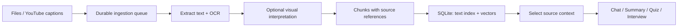

# LearnFlow AI

### Turn “I’ve read it” into “I can explain it.”

**Upload your sources. Ask better questions. Put your understanding to the test.**

LearnFlow AI turns PDFs, slides, images, and captioned YouTube videos into a learning workspace for **chat, summaries, quizzes, and mock interviews**. Follow references back to the page, slide, image, or timestamp behind the response.

**React + TypeScript · FastAPI · SQLite · Google Document AI · Jina AI · Amazon Bedrock**

[Explore](#one-workspace-from-reading-to-recall) · [Architecture](#the-engineering-behind-the-experience) · [Run locally](#run-locally) · [Data & limits](#data-costs-and-current-limits) · [Deploy](#deployment)

> **Current stage:** A working prototype for personal use and small demonstrations, running on one persistent backend. Storage is local to that backend; AI processing uses cloud providers.

## One workspace, from reading to recall

| Action | What you get |
| --- | --- |
| **Ask** | Chat across selected sources, with inspectable evidence and saved conversations. |
| **Condense** | Generate summaries from your materials. |
| **Test** | Single-answer, multiple-answer, short-answer, and mixed quizzes with scoring. |
| **Rehearse** | Role-aware mock interviews using optional résumé text and selected materials, with feedback and reports. |
| **Verify** | Open source references and inspect extracted content in History. |

**Inputs:** PDF · PPTX · PNG · JPG/JPEG · public YouTube URLs with accessible captions.

**Workflow:** Add material → wait for **Ready** → select sources → ask, summarize, test, or rehearse → inspect the evidence.

Accounts, per-user material ownership, export, deletion, and an admin usage view support the learning workflow. Nine themes include light and dark modes.

## The engineering behind the experience

LearnFlow uses retrieval-augmented generation (RAG) for chat: it finds relevant passages in your selected sources and sends that evidence to the model. Summaries, quizzes, and interviews use bounded selections of processed source content.



| Design choice | Why it matters |
| --- | --- |
| **Native text + OCR + visual interpretation** | Reads document text and images; optional descriptions add context for selected diagrams. Literal text and generated interpretations are stored separately. |
| **Chunks respect source boundaries** | Retains page, slide, image, or timestamp references through indexing and retrieval. |
| **Hybrid search in SQLite** | Combines FTS5 keyword search and dense embedding search using reciprocal rank fusion, without a separate vector database. Falls back to lexical results if query embeddings are unavailable. |
| **A separate ingestion worker** | Keeps OCR and embedding out of upload requests. Processes one job at a time and requeues stale, interrupted work. |
| **Source access checked on the server** | Restricts retrieval to authorized materials. Video chat excludes chunks extending beyond the supplied playback position. |
| **Quiz scoring runs on the server** | Withholds answer keys when serving questions, then returns results and explanations after submission. |

**Grounding has limits.** Chat refuses when it retrieves no eligible evidence. Its citations identify retrieved passages; they do not verify every generated claim. Extraction, retrieval, and model output can still be wrong.

## Run locally

Use **Git, Node.js 22.12+ and Python 3.11+**. CI uses Node.js 22 and Python 3.11. The default cloud configuration needs Google Document AI, Jina AI, and Bedrock credentials.

### 1. Install

```powershell
git clone https://github.com/ZigzagDeck/LearnflowAI.git
cd LearnflowAI
git checkout vm

npm ci
python -m venv .venv
.\.venv\Scripts\python.exe -m pip install -r backend\requirements.txt
Copy-Item .env.example .env
```

### 2. Set credentials

Edit `.env`. See [.env.example](.env.example) for provider options, model settings, and usage limits.

| Purpose | Configuration |
| --- | --- |
| **OCR** | `GOOGLE_CLOUD_PROJECT`, `GOOGLE_DOCUMENT_AI_LOCATION`, `GOOGLE_DOCUMENT_AI_PROCESSOR_ID`; authenticate with `GOOGLE_APPLICATION_CREDENTIALS` or `LEARNFLOW_GOOGLE_SERVICE_ACCOUNT_JSON`. |
| **Embeddings** | Set `JINA_API_KEY`. |
| **Generation** | Set `LEARNFLOW_BEDROCK_CHAT_ENABLED=true`, `AWS_REGION`, `AWS_BEARER_TOKEN_BEDROCK`, and `LEARNFLOW_BEDROCK_MODEL_ID`. |
| **Admin access (optional)** | Set both `LEARNFLOW_ADMIN_EMAIL` and `LEARNFLOW_ADMIN_PASSWORD`; the API creates or updates that account on startup. No default password is provided. |

**Check the defaults:** Bedrock chat is disabled in the example, while visual interpretation is enabled. Configure Bedrock for the full experience, or set `LEARNFLOW_VISUAL_UNDERSTANDING_ENABLED=false` to skip visual interpretation. Local OCR and embedding fallbacks are disabled by default.

Keep `.env`, service-account JSON, database files, and uploads out of version control.

### 3. Start three processes

Run each command in a separate PowerShell terminal from the project root:

```powershell
# API
.\.venv\Scripts\python.exe -m uvicorn backend.main:app --reload --port 8000
```

```powershell
# Ingestion worker
.\.venv\Scripts\python.exe -m backend.worker
```

```powershell
# Frontend
npm run dev
```

Open [localhost:5173](http://localhost:5173), create an account, and add your first material. Keep the worker running during ingestion. Check the API at [localhost:8000/health](http://localhost:8000/health).

## Data, costs, and current limits

### Where your data goes

| Destination | Data handled |
| --- | --- |
| **Your backend machine** | SQLite stores accounts, extracted content, chunks, embeddings, learning history, jobs, and usage counters. Original uploads remain on disk. |
| **Google Document AI** | Receives images or rendered document content for OCR, directly without Google Cloud Storage. |
| **Jina AI** | Receives chunk text and search queries for embeddings in the default configuration. |
| **Amazon Bedrock** | Receives source context for generation and selected visuals for interpretation. It is the only AWS service used. |

**Local storage does not mean offline processing.** Cloud calls may incur charges. The app enforces configurable monthly usage limits; use provider-side budgets too. Deleting the database resets local usage counters.

### What to expect

- **YouTube requires accessible captions.** No audio/video download or speech transcription. Private, restricted, captionless, or host-blocked videos may be unavailable.
- **Chat uses your selected sources.** It does not search the web for answers. Bounded context selection can omit relevant details, especially in large materials.
- **Deployment targets one persistent machine.** Multi-instance coordination and object storage are outside the current implementation.
- **Public production use needs further work.** Authentication, rate limits, and ownership checks are implemented. Email verification, password recovery, managed backups, edge controls, monitoring, and secret rotation remain deployment responsibilities or missing features.

### Back up both records and files

| Default path | Contents |
| --- | --- |
| `backend/data/learnflow.db` | Database and indexes |
| `backend/uploads/` | Original uploaded files |
| `backend/data/models/` | Optional local model cache |

These paths are Git-ignored. Back up the database and uploads together. Account export includes portable records and extracted content, **not original file bytes**.

## Deployment

Host the frontend on **Cloudflare Pages** and keep the FastAPI API, worker, SQLite database, and uploads on one persistent machine.

1. Push the `vm` branch and select it when importing the repository into Pages.
2. Set build command `npm run build` and output directory `dist`.
3. Give the API a stable HTTPS hostname through a named Cloudflare Tunnel mapped to `http://localhost:8000`.
4. Before building, set the Pages variable `VITE_API_BASE_URL=https://api.your-domain.example`.
5. Set backend `LEARNFLOW_CORS_ORIGINS` to the exact frontend origin and restart the API.
6. Keep the backend machine, API, worker, and tunnel online.

In a deployed frontend, `localhost` points to the visitor’s computer. Use the API’s HTTPS hostname and avoid exposing port 8000 directly through your router. The API command above uses development reload; use a persistent process without `--reload` for a hosted demonstration.

## Development and verification

```powershell
npm run lint
npm run build
.\.venv\Scripts\python.exe -m pip install -r backend\requirements-dev.txt
.\.venv\Scripts\python.exe -m compileall -q backend
.\.venv\Scripts\python.exe -m pytest backend\tests -q
```

[CI](.github/workflows/ci.yml) defines frontend lint/build, backend compilation/tests, and a Docker API health smoke check. Tests cover authentication and API contracts, uploads, extraction, chunking, retrieval, provider integrations, and learning services.

## Find your way around

| Area | Entry points |
| --- | --- |
| **Interface** | [`src/`](src/) — React workspace and themes |
| **API and jobs** | [`main.py`](backend/main.py), [`worker.py`](backend/worker.py), [`processing.py`](backend/processing.py) |
| **Persistence** | [`resource_store.py`](backend/resource_store.py) — SQLite schema, records, and indexes |
| **Ingestion** | [`extraction.py`](backend/extraction.py), [`ocr.py`](backend/ocr.py), [`visual_understanding.py`](backend/visual_understanding.py), [`youtube_ingestion.py`](backend/youtube_ingestion.py) |
| **Search** | [`chunking.py`](backend/chunking.py), [`embeddings.py`](backend/embeddings.py), [`retrieval.py`](backend/retrieval.py) |
| **Learning** | `backend/*_service.py` — chat, summaries, quizzes, and interviews |
| **Validation and decisions** | [`backend/tests/`](backend/tests/), [`REPORT.md`](REPORT.md) |
